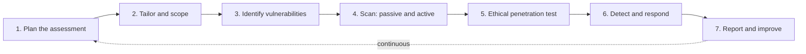

# Security Assessment Lab

A guide to security assessment and testing: planning, scoping, vulnerability identification, scanning, ethical penetration testing, detection and response, and continuous improvement. Companion to the animated web page `security-assessment-lab.html`.

## The basics

**What a security assessment is.** It checks whether controls are implemented as designed, operate as expected and achieve the desired result. Independent assessors usually run it, using standards such as SOX, HIPAA or GDPR.

**Where it happens.** Any level (unit, subsystem, full system), any environment (development, sandbox, production), by developers, end users, third parties or a mix.

**When it happens.** Management decides: before an audit, continuously, with no notice, or for certification and accreditation.

**Assessment vs audit.** An assessment finds and fixes weaknesses; a formal audit assures external evaluators that controls meet compliance expectations. Results feed continual improvement.

**Myth: testing is only for development.** Reality: systems often ship with too little functional testing, and commercial systems often neglect security, safety, resilience and data protection. Deployed systems need assessment all the time.

## The assessment lifecycle (simulation steps)

### 1. Plan the assessment

*On screen:* Assessors, staff and systems are lined up before any testing starts.

**Working principle**

1. Set the purpose: compliance-required, or assurance for leaders and outside stakeholders.
2. Arrange participants (badges, workspaces, parking), access to information and systems, and private staff interviews.
3. Agree reliable communication channels between assessors, their managers and your team.

**Pros**

- Avoids surprises and downtime
- Teaches you the business processes and controls

**Cons**

- Can take months of coordination
- Data and knowledge are shared with outsiders

**Used in:** SOX, HIPAA and GDPR audits; ISO 27001 certification; FedRAMP third-party assessments.

### 2. Tailor and scope

*On screen:* Only the sampled systems stay lit; the rest are out of this round.

**Working principle**

1. Review what changed since last time: threat landscape, business logic, compliance regime.
2. Update the security requirements baseline; choose control types and depth.
3. Pick samples: statistical (probability laws) or judgmental (assessor targets the riskiest). Mix examinations, tests and interviews.
4. Protect confidentiality, integrity and availability; give assessors least privilege.

**Pros**

- Focused on current risk
- Saves effort on large estates

**Cons**

- Sampling can miss rare flaws
- Judgmental sampling relies on assessor skill

**Used in:** Banks sample branches and systems; hospitals prioritise systems with patient data; defence programmes scope by system boundary under RMF.

### 3. Identify vulnerabilities

*On screen:* An inventory is matched against CVE data and weak spots light up.

**Working principle**

1. Build or refresh the asset inventory and baseline.
2. Match items against CVE records (NVD, MITRE), for example SNMP flaws.
3. Mine internal sources: helpdesk tickets, change control, complaints. Frustrated users bypass controls.
4. Classify: hardware failure, load-induced failure, design error, procedural error; add physical, administrative and people gaps such as tacit knowledge.

**Pros**

- Cheap and repeatable
- Ranks fixes by criticality and risk

**Cons**

- Finds only known issues
- More assets than time to assess

**Used in:** Enterprise patch programmes; scanners such as Nessus, OpenVAS and Qualys use NVD feeds.

### 4. Scan: passive and active

*On screen:* Probes travel from the scanner to each system; credentials go deeper.

**Working principle**

1. Get management approval and set a schedule (daily, weekly, monthly).
2. Passive: scan and report without exploiting. Active: use credentials to log in and find deeper flaws.
3. Run discovery scans for new equipment and compliance scans against security baselines.
4. Rank results by criticality and risk.

**Pros**

- Compares security posture over time
- Finds rogue devices and configuration drift

**Cons**

- Can crash a host or network, even with gentle tests
- A badly designed test wastes effort

**Used in:** PCI DSS quarterly scans; CISA scanning services for US agencies; cloud posture tools.

### 5. Ethical penetration test

*On screen:* A red packet chains weaknesses from the internet to staff PCs.

**Working principle**

1. Agree written rules of engagement.
2. Target unmitigated vulnerabilities and ones earlier updates should have fixed, around critical processes.
3. Chain exploits as an attacker would. SUNBURST (SolarWinds, 2019–2021) shows how one trusted update reached tens of thousands of organisations.
4. Report evidence and the attack path.

**Pros**

- Proves real exploitability
- Shows how controls work together

**Cons**

- Point-in-time result
- Risk of disruption; needs skilled testers

**Used in:** PCI DSS annual pen tests; Hack the Pentagon bug bounty (2016); TIBER-EU and CBEST red teaming in finance.

### 6. Detect and respond

*On screen:* Events stream in; suspicious ones escalate as IOC/IOA alarms.

**Working principle**

1. Events: any activity (people, network, endpoint, software).
2. Events of interest: may need human investigation.
3. IOCs and IOAs define alarm-worthy conditions that alert security and operations teams.
4. Chaos engineering: no-notice failure injection tests detection, response and recovery.

**Pros**

- Tests people and process, not just tools
- Shortens detection and recovery time

**Cons**

- Chaos tests are costly if systems lack resilience
- Insider-scripted, so not a true attacker simulation

**Used in:** SOCs with SIEM; Netflix Chaos Monkey; military cyber exercises and red-team drills.

### 7. Report and improve

*On screen:* Fixes turn green and the cycle restarts, ideally nonstop.

**Working principle**

1. Communicate results consistently so management understands risk.
2. Record gaps in the risk register; fix and retest.
3. Feed policy and process improvement.
4. Move toward continuous assessment: automation, breach attack simulation, threat intelligence, change management.

**Pros**

- Always-current view of risk
- Supports continuous monitoring

**Cons**

- Needs automation and people
- No approach guarantees control effectiveness

**Used in:** BAS platforms (AttackIQ, SafeBreach, Picus); DevSecOps pipelines; FedRAMP continuous monitoring.

## Types of assessment

| Type | Trigger | How it works | Pro | Con | Used in |
|---|---|---|---|---|---|
| Formal / compliance | Law, regulation or contract requires proof of financial, safety, privacy or data-protection controls. | Independent assessors follow a standard, collect evidence, then report to management and external stakeholders. | Credible assurance; opens or keeps business. | Costly; point-in-time. | SOX, HIPAA, GDPR, PCI DSS audits. |
| Ad hoc / informal | Follow-up to an anomaly or incident, or a change in vendors, business logic, procedures or strategy. | Focus on one subsystem or process, or rehearse the full formal assessment. | Fast, proactive; prepares for formal audits. | Less rigorous; not accepted as formal assurance. | Post-incident reviews; pre-audit readiness checks. |
| Mergers and acquisitions | One organisation buys or combines with another. | Inventory unknown systems, assess both risk postures and controls, and capture tacit knowledge before people leave. | Reveals inherited risk before integration. | Little insider knowledge; time pressure. | Due diligence in tech, banking and defence contractor deals. |
| Internal change | Staff departure under duress, system changes, cloud or CSP migration, restructuring, post-incident remediation, or a baseline before major change. | Regression testing and targeted control checks around the change. | Catches new gaps early; sets a baseline. | Needs rapid scheduling. | Cloud migrations; offboarding of privileged users. |
| Continuous / BAS | Need for nonstop assurance instead of event-driven testing. | Automated and semi-automated tools run attack simulations continuously, fed by threat intelligence and linked to change management. | Always current; complements continuous monitoring. | Tooling cost; alert fatigue. | Large enterprises, finance, SaaS providers. |
| Chaos engineering | Need to test detection, response and recovery under real stress. | Force production failures with no notice; responders treat them as real attacks. | Reveals true resilience. | Can be costly or unsafe if systems are fragile. | Cloud-native firms such as Netflix; mature SOCs. |

## Where weaknesses come from

- **Hardware failure or degradation:** Thermal and power cycling, surges and interruptions damage components, intermittently or permanently.
- **Load and usage-induced failure:** Systems run near capacity: memory paging shortages, congested links, brownouts.
- **Design errors:** Flaws in requirements or design make hardware, software or procedures misbehave.
- **Procedural errors:** Poor system design or weak training and skills of users and maintainers.

## Used in the real world

| Domain | Examples |
|---|---|
| Commercial / retail | PCI DSS requires quarterly vulnerability scans and annual penetration tests for card data. BAS tools validate controls between audits. |
| Defense | DoD uses RMF assessments, DISA STIGs and CMMC for contractors. Hack the Pentagon (2016) opened systems to vetted researchers. |
| Government | FedRAMP uses 3PAOs for cloud authorisation. CISA offers scanning and assessment services to agencies. |
| Healthcare | HIPAA requires risk analysis; hospitals scan medical devices carefully because aggressive tests can disrupt care. |
| Finance | SOX control testing, plus TIBER-EU and CBEST threat-led red teaming for critical firms. |
| Critical infrastructure | OT/ICS assessments under IEC 62443 and NERC CIP, with passive methods to avoid halting plants. |
| Technology / cloud | Continuous scanning in DevSecOps, bug bounties and chaos engineering such as Netflix’s Chaos Monkey. |

## Glossary

| Term | Full form | Meaning |
|---|---|---|
| AICPA | American Institute of Certified Public Accountants | Publishes the SSAE attestation standards. |
| BAS | Breach Attack Simulation | Automated tools that continuously simulate attacks. |
| CIA | Confidentiality, Integrity, Availability | The three core security goals. |
| CMMC | Cybersecurity Maturity Model Certification | US DoD requirement for defence contractors. |
| CSP | Cloud Service Provider | Hosts cloud services, for example AWS or Azure. |
| CVE | Common Vulnerabilities and Exposures | Public catalogue of known vulnerabilities. |
| FedRAMP | Federal Risk and Authorization Management Program | US government cloud security authorisation. |
| GDPR | General Data Protection Regulation | EU data-protection law. |
| HIPAA | Health Insurance Portability and Accountability Act | US health-data privacy law. |
| ICS | Industrial Control System | Systems running physical processes. |
| IOA | Indicator of Attack | Evidence an attack is in progress. |
| IOC | Indicator of Compromise | Evidence a system was compromised. |
| IS | Information System | Hardware, software, data, people and procedures. |
| ISO | International Organization for Standardization | Publishes standards such as ISO 27001. |
| ISP | Internet Service Provider | Supplies internet connectivity. |
| IT | Information Technology | Business computing and networks. |
| M&A | Mergers and Acquisitions | Combining or buying organisations. |
| MITRE | MITRE Corporation (a name, not an acronym) | Maintains the CVE programme. |
| NIST | National Institute of Standards and Technology | US body publishing security frameworks. |
| NVD | National Vulnerability Database | NIST’s enriched CVE database. |
| OECD | Organisation for Economic Co-operation and Development | Issues governance best practices. |
| OT | Operational Technology | Technology controlling physical equipment. |
| PCI DSS | Payment Card Industry Data Security Standard | Rules for card-data protection. |
| RMF | Risk Management Framework | NIST process for assessing and authorising systems. |
| SIEM | Security Information and Event Management | Collects and correlates security events. |
| SMB | Small and Medium Business | Smaller organisation; also a file-sharing protocol. |
| SNMP | Simple Network Management Protocol | Manages network devices; a common CVE source. |
| SOC | Security Operations Center | Team monitoring and responding to alerts. |
| SOX | Sarbanes-Oxley Act | US financial reporting and controls law. |
| SSAE | Statements on Standards for Attestation Engagements | AICPA standards for control reports. |
| STIG | Security Technical Implementation Guide | DISA hardening baselines for US defence. |
| SUNBURST | Name of the SolarWinds supply-chain malware | Hidden in a trusted software update. |
| TIBER-EU | Threat Intelligence-Based Ethical Red Teaming | EU framework for financial-sector red teams. |
| 3PAO | Third-Party Assessment Organization | Independent FedRAMP assessor. |
